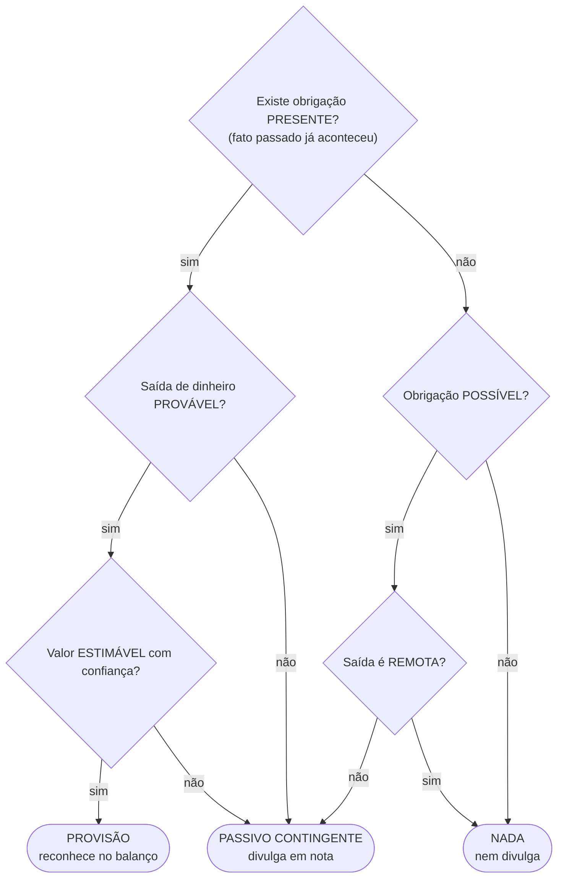

# A dívida que talvez venha e o ganho que talvez chegue

**SEMEF Manaus 2026 · Auditor Fiscal · Banca FCC · Aula do zero**

Provisões, passivos contingentes e ativos contingentes (CPC 25), construídos a partir dos conceitos primitivos, com histórias, desenhos e o mapa de decisão completo.

- **Disciplina:** Contabilidade
- **Norma:** CPC 25
- **Nível:** do zero → prova
- **Resposta da âncora:** B · III e IV

## Índice

- 00 A questão e o mapa da aula
- 01 N0 · Ativo e passivo
- 02 N0 · Reconhecer × divulgar
- 03 N0 · A régua da probabilidade
- 04 N1 · Fato passado e obrigação presente
- 05 N2 · Provisão: as 3 condições
- 06 N2 · Quanto provisionar (estimativa e valor presente)
- 07 N2 · Passivo contingente
- 08 N2 · Ativo contingente e a prudência
- 09 N3 · A parábola da Dona Rosa
- 10 N3 · A vida de um processo no tempo
- 11 N4 · O mapa completo e o fluxograma
- 12 A questão resolvida + armadilhas
- 13 Cenário: o Auditor lendo o balanço
- 14 Simulado: 4 questões reais
- 15 Gabarito comentado e fontes
- 16 Cola de revisão

**Legenda das caixas:** BASE (precisa ficar sólido) · ATENÇÃO (detalhe que muda a resposta) · PONTO CEGO FCC (onde mora a pegadinha) · COMO CAIRIA (formato provável).

---

## 00 · A questão e o mapa

### Leia, chute e siga a trilha

> **Questão de partida · FCC 2026 · SEFAZ-GO · Auditor Fiscal (Q4508293)**
>
> Em relação aos ativos e passivos contingentes, considere as seguintes afirmações:
>
> - I. Todos os ativos contingentes devem ser reconhecidos e contabilizados.
> - II. Todos os passivos contingentes devem ser reconhecidos e contabilizados.
> - III. As provisões devem ser reconhecidas e contabilizadas se as perdas forem consideradas prováveis.
> - IV. Os ativos contingentes não devem ser reconhecidos.
>
> Está correto o que se afirma APENAS em:
>
> - A. II e IV.
> - B. III e IV.
> - C. II, III e IV.
> - D. I e III.
> - E. II e III.

Em português simples: **"quando uma dívida ou um ganho ainda incerto deve entrar no balanço, e quando só deve ser comentado?"**

### A trilha

| Nível | Tema | Conteúdo |
|---|---|---|
| **0** | O balanço | ativo · passivo · reconhecer × divulgar · régua da chance |
| **1** | A origem da dívida | fato passado · obrigação presente (legal ou não formalizada) |
| **2** | Os três personagens | provisão · passivo contingente · ativo contingente |
| **3** | A história da Dona Rosa | 4 processos · a vida de um processo no tempo |
| **4** | O mapa de decisão | matriz completa · fluxograma · questão resolvida |

Cada nível usa só o que veio antes. A resposta da questão sai sozinha no Nível 4.

> **REGRA DESTA AULA**
> Nenhum termo aparece "do nada". Cada conceito vem com: (1) o que é, em palavras simples, (2) uma história ou analogia, (3) um desenho e (4) um checkpoint para você testar.

---

## 01 · Nível 0

### Ativo e passivo: o que traz e o que tira dinheiro

O **balanço patrimonial** (a "foto" financeira da empresa num dia) tem dois lados: o que a empresa tem e o que ela deve.

| ATIVO: o que vai TRAZER dinheiro | PASSIVO: o que vai TIRAR dinheiro |
|---|---|
| caixa e banco | fornecedores a pagar |
| estoque | empréstimos |
| clientes a receber | impostos a pagar |
| máquinas e imóveis | salários a pagar |
| *entra dinheiro no futuro* | *sai dinheiro no futuro* |

Ativo: benefício que vai entrar. Passivo: sacrifício que vai sair.

**Legenda**

- **Ativo:** recurso controlado pela empresa que deve gerar **benefício futuro** (entrada de dinheiro).
- **Passivo:** obrigação **presente** da empresa que deve gerar **saída de recursos** no futuro.
- **Resultado:** receitas − despesas = lucro (ou prejuízo). Uma despesa nova **reduz o lucro**.

> **ANALOGIA · a sua carteira**
> O dinheiro que um amigo te deve é o seu **ativo** (vai entrar). A fatura do cartão é o seu **passivo** (vai sair). Até aqui, tudo é **certo**: você sabe que deve e quanto deve. A aula de hoje trata do que é **incerto**.

> **CHECKPOINT 1**
> Classifique: (a) salários do mês a pagar; (b) valor que um cliente ainda vai pagar; (c) empréstimo bancário.
> **Respostas:** (a) passivo; (b) ativo; (c) passivo.

---

## 02 · Nível 0

### Reconhecer × divulgar

Este é o par de verbos mais importante da aula. A questão inteira gira em torno dele.

| RECONHECER = lançar no balanço | DIVULGAR = só contar em nota |
|---|---|
| **Balanço patrimonial:** Caixa 100.000 · Fornecedores 40.000 · **Provisão p/ processos 50.000** · Patrimônio líquido 10.000 | **Nota explicativa nº 12:** "A empresa responde a uma ação movida por um vizinho, no valor de R$ 30 mil. Os advogados avaliam a perda como possível." |
| Tem número, entra na soma, mexe no lucro. | Só texto: não entra na soma. |

À esquerda, o número entra na conta. À direita, o fato é só contado em texto.

| Verbo | O que significa | Efeito |
|---|---|---|
| **Reconhecer** (contabilizar) | lançar o valor no balanço, com débito e crédito | muda os totais e, se for despesa, **reduz o lucro** |
| **Divulgar** | escrever nas **notas explicativas** (textos que acompanham o balanço) | não muda nenhum número; só informa o leitor |
| **Nada** | nem lança, nem comenta | o fato é ignorado |

> **ANALOGIA · o boletim escolar**
> A **nota** da prova entra na média (reconhecer). O **comentário** do professor no rodapé ("aluno pode melhorar em frações") não muda a média, mas informa os pais (divulgar).

> **ATENÇÃO · na prova**
> A FCC usa "reconhecidos e contabilizados" como sinônimos: os dois significam **entrar no balanço**. Não confunda com divulgar.

---

## 03 · Nível 0

### A régua da probabilidade

**Pergunta antes da teoria:** se a advogada diz "acho que vamos perder", "pode ser que percamos" ou "quase impossível perder", a empresa deve agir igual nos três casos?

Não. O CPC 25 organiza as incertezas numa régua de chances. Cada faixa leva a um tratamento diferente.

```
Quão provável é o dinheiro sair (ou entrar)?

  REMOTA    │      POSSÍVEL        │       PROVÁVEL         │ PRAT. CERTO
 quase nunca│  pode ser que sim    │  mais sim do que não   │ só falta acontecer
  ──────────┴──────────────────────┼────────────────────────┴──────────────
  0%                              50%                                    100%

"Provável" no CPC 25 = mais chance de acontecer do que de não acontecer
```

As faixas não têm percentuais oficiais, exceto o "provável": mais de 50% de chance (mais provável que sim do que não).

| Faixa | Fala típica da advogada | Exemplo do dia a dia |
|---|---|---|
| **Remota** | "chance quase zero" | meteorito cair no seu carro |
| **Possível** | "pode ser que sim, pode ser que não" | chover no fim de semana em Manaus em agosto |
| **Provável** | "acho que vamos perder" | trânsito na Djalma Batista às 18h |
| **Praticamente certo** | "acabou, já está decidido" | o sol nascer amanhã |

> **GUARDE**
> Toda a aula é a combinação de **duas perguntas**: (1) o dinheiro vai **sair** (passivo) ou **entrar** (ativo)? (2) em que **faixa da régua** está a chance?

> **CHECKPOINT 2**
> A advogada diz: "temos 70% de chance de perder". Em que faixa isso cai?
> **Resposta:** provável (mais de 50%).

---

## 04 · Nível 1

### Fato passado e obrigação presente

Só existe dívida hoje se algo **já aconteceu** que prende a empresa. Esse "algo" é o **evento passado** (fato gerador da obrigação).

| Situação | Fato passado? | Conclusão |
|---|---|---|
| A obra causou infiltração no apartamento do cliente | **sim** (o dano já ocorreu) | pode haver obrigação presente |
| A empresa planeja reformar a sede no ano que vem | **não** (é só intenção) | não há obrigação: a empresa pode desistir |
| Prejuízos operacionais esperados para o próximo ano | **não** | não se provisiona prejuízo futuro |

### Dois jeitos de ficar "preso"

1. **Obrigação legal:** nasce de contrato, lei ou decisão judicial. Ex.: o Código do Consumidor obriga a consertar o defeito.
2. **Obrigação não formalizada (ou "construtiva"):** nasce de um costume público da empresa que cria expectativa válida nas pessoas. Ex.: uma loja anuncia há anos "devolvemos seu dinheiro em 60 dias, sem perguntas", mesmo que a lei exija menos.

> **ANALOGIA · a promessa no grupo da família**
> Ninguém te obriga por lei a pagar o churrasco de domingo. Mas, se você anuncia todo mês no grupo da família que vai pagar, todos passam a contar com isso. Você está "preso" pela expectativa que criou: é a obrigação não formalizada.

> **PONTO CEGO · plano não é dívida**
> "A empresa pretende…", "a diretoria estuda…", "prejuízos esperados…" → **não** geram provisão. Se a empresa pode escapar da saída de dinheiro por decisão própria, não há obrigação presente.

---

## 05 · Nível 2

### Provisão: a dívida incerta que entra no balanço

**Provisão** (CPC 25) = um passivo de **prazo ou valor incertos**. A empresa sabe que deve, mas não sabe exatamente quando ou quanto vai pagar.

```
 ┌──────────────────┐   ┌──────────────────┐   ┌──────────────────┐   ┌──────────────┐
 │ ✓ Obrigação      │ + │ ✓ Saída          │ + │ ✓ Valor          │ = │  PROVISÃO    │
 │   PRESENTE       │   │   PROVÁVEL       │   │   ESTIMÁVEL      │   │  reconhece   │
 │ nasce de um fato │   │ mais chance de   │   │ dá para calcular │   │  no balanço  │
 │ que JÁ aconteceu │   │ pagar do que não │   │ com confiança    │   │              │
 └──────────────────┘   └──────────────────┘   └──────────────────┘   └──────────────┘

 Faltou qualquer um dos três? Não é provisão (vira passivo contingente ou nada).
```

As três condições precisam estar presentes **ao mesmo tempo**.

| Tipo de passivo | Quanto? Quando? | Exemplo |
|---|---|---|
| Passivo comum | valor e data certos | fatura de R$ 10 mil do fornecedor, vence dia 15 |
| **Provisão** | valor e/ou data **estimados** | processo que deve custar "uns R$ 50 mil", sem data |

### O lançamento contábil (reconhecer)

```
D – Despesa com provisão
C – Provisão (passivo)
```

D = débito · C = crédito. Na prática: a despesa sobe (o lucro cai) e o passivo sobe, pelo mesmo valor.

> **ANALOGIA · a conta de luz que ainda não chegou**
> Você usou energia o mês todo (fato passado). A conta ainda não chegou, mas você **sabe** que vem e tem uma boa ideia do valor. Então já separa o dinheiro. Isso é provisionar.

> **COMO CAIRIA**
> "Item que atende a todos os requisitos: obrigação presente de eventos passados, saída provável e estimativa confiável" → a resposta é **provisão** (não "reserva de contingência", que é outra coisa, do patrimônio líquido).

---

## 06 · Nível 2

### Quanto provisionar?

#### Regra 1 · A melhor estimativa

O valor da provisão é a **melhor estimativa** (o valor mais razoável para quitar a obrigação na data do balanço).

**Caso A · um único processo:** a advogada estima perder entre R$ 220 e R$ 260, sendo R$ 240 o mais provável → provisão de **R$ 240** (o resultado mais provável, não o maior nem o menor).

**Caso B · muitas ocorrências parecidas (garantias):** não dá para saber qual produto vai quebrar, mas dá para usar a experiência. Pense em **100 vendas**:

| O que acontece | Chance | Custo de cada | Em 100 vendas |
|---|---|---|---|
| sem defeito | 75% | R$ 0 | 75 × 0 = 0 |
| defeito pequeno | 20% | R$ 100 | 20 × 100 = 2.000 |
| defeito grande | 5% | R$ 400 | 5 × 400 = 2.000 |
| **Total para 100 vendas → por venda: 4.000 ÷ 100** | | | **R$ 40** |

Dividir por 100 é o mesmo que multiplicar cada custo pela sua chance: 0,75 × 0 + 0,20 × 100 + 0,05 × 400 = 0 + 20 + 20 = **R$ 40**. Isso é o **valor esperado** (média ponderada pelas chances).

#### Regra 2 · Se o pagamento é distante, traga a valor presente

```
        IDA: × 1,10 (rende 10%)
   ┌──────────────────────────────────┐
   ▼                                  │
 R$ 100 ───────────────────────────► R$ 110
 HOJE                           DAQUI A 1 ANO
   ▲                                  │
   └──────────────────────────────────┘
        VOLTA: ÷ 1,10 (desconta 10%) = valor presente
```

Pagar R$ 110 daqui a 1 ano equivale a ter R$ 100 hoje, se o dinheiro rende 10% ao ano.

1. **Ida (juros):** R$ 100 aplicados a 10% viram 100 × 1,10 = 110. Em geral: `VF = VP × (1 + i)ⁿ`.
2. **Volta (desfazer):** o contrário de multiplicar é dividir: `VP = VF ÷ (1 + i)ⁿ`. Exemplo: 110 ÷ 1,10 = 100. Em 2 anos: 121 ÷ 1,10² = 121 ÷ 1,21 = 100.

VP = valor presente (hoje) · VF = valor futuro (a pagar) · i = taxa por período · n = número de períodos.

> **ATENÇÃO · o efeito do tempo**
> Quando o efeito do dinheiro no tempo é **material** (relevante), a provisão é registrada pelo **valor presente** dos desembolsos. A cada ano, a provisão "cresce" até o valor futuro: esse aumento é **despesa financeira**. Ex.: provisão de 620 a 10% → no 1º ano, D Despesa financeira 62 / C Provisão 62.

---

## 07 · Nível 2

### Passivo contingente: a dívida que fica só na nota

**Contingente** (do latim: "que pode acontecer ou não"). O passivo contingente é a dívida que **não passa** no teste das três condições da provisão.

#### Ele aparece em duas situações

- **A · Obrigação apenas possível:** ainda não se sabe se a dívida existe. Ela só será confirmada por um evento futuro incerto, que a empresa não controla totalmente (ex.: a decisão de um juiz).
- **B · Obrigação presente, mas que falha num teste:** (i) a saída de dinheiro não é provável, ou (ii) o valor não pode ser estimado com confiança.

| Chance de saída | Classificação | Tratamento |
|---|---|---|
| provável + estimável | **provisão** | reconhece no balanço |
| possível | **passivo contingente** | só divulga em nota |
| remota | (nada) | nem reconhece, nem divulga |

> **ANALOGIA · a previsão do tempo**
> Previsão de "possibilidade de chuva": você não cancela o passeio (não reconhece), mas avisa a família para levar casaco (divulga). Previsão de chuva "remota": nem comenta.

> **PONTO CEGO FCC · "todos"**
> "Todos os passivos contingentes devem ser reconhecidos" é **falso**: passivo contingente **nunca** é reconhecido. Se fosse reconhecido, seria provisão.

> **CHECKPOINT 3**
> Obrigação presente, perda provável, mas o valor é impossível de estimar. É provisão?
> **Resposta:** não. Falhou a condição 3 → passivo contingente (só nota). É raro, mas acontece.

---

## 08 · Nível 2

### Ativo contingente e a prudência

**Ativo contingente** = um ativo **possível**, que vem de eventos passados e cuja existência só será confirmada por eventos futuros incertos, fora do controle total da empresa. É um "direito que talvez exista".

| Chance de entrar dinheiro | Classificação | Tratamento |
|---|---|---|
| praticamente certa | **ativo normal** (deixa de ser contingente) | **reconhece** |
| provável | ativo contingente | **só divulga** em nota |
| possível ou remota | ativo contingente | nada |

**A assimetria: o mesmo "provável" tem tratamentos diferentes para dívida e para ganho.**

| NOTÍCIA RUIM (dívida) | NOTÍCIA BOA (ganho) |
|---|---|
| provável → **JÁ ENTRA no balanço** (provisão) | provável → **AINDA NÃO entra** (só nota explicativa) |
| leva o guarda-chuva se a chuva é provável | não gasta a herança antes de recebê-la |

**PRUDÊNCIA: não superestimar ativos nem subestimar passivos.**

> **PARÁBOLA · a herança do tio**
> O tio diz que vai deixar uma casa para você. Você não compra móveis novos no cartão contando com ela: o testamento pode mudar, o inventário pode demorar. Você comenta com a família (divulga), mas só conta com a casa quando a escritura estiver no seu nome (praticamente certo → reconhece).

> **POR QUE ASSIM?**
> Reconhecer um ganho que talvez não venha **inflaria o lucro** e poderia levar à distribuição de dividendos de dinheiro inexistente. Por isso: ativo contingente **não se reconhece**. Afirmar isso, como faz a afirmativa IV, está correto.

---

## 09 · Nível 3

### A parábola da Dona Rosa

Dona Rosa tem uma construtora em Manaus. É 31 de dezembro, dia de fechar o balanço. A advogada chega com quatro pastas.

| Pasta | Situação | Fala da advogada | Faixa | Tratamento |
|---|---|---|---|---|
| **1** | Cliente processa (infiltração no apto.) | "Vamos perder: uns R$ 50 mil" | PROVÁVEL | **PROVISÃO** (reconhece) |
| **2** | Vizinho processa (barulho da obra) | "Pode ser que a gente perca" | POSSÍVEL | **PASSIVO CONTINGENTE** (só nota) |
| **3** | Ação sem sentido (pedido absurdo) | "Chance quase zero" | REMOTA | **NADA** (nem nota) |
| **4** | Rosa processa fornecedor (cimento) | "Acho que ganhamos 80 mil" | PROVÁVEL | **ATIVO CONTINGENTE** (só nota) |

Processos 1 a 3: alguém cobra a Rosa (passivo). Processo 4: a Rosa cobra alguém (ativo).

Mesmo dia, mesma empresa, quatro tratamentos diferentes. O que decide é a **direção do dinheiro** e a **faixa da régua**.

| Pasta | Por que esse tratamento | O que aparece nas demonstrações |
|---|---|---|
| 1 | dano já ocorreu, perda provável, valor estimado | Provisão de R$ 50 mil no passivo; despesa no resultado |
| 2 | perda só possível | Nota: "ação de vizinho, R$ 30 mil, perda possível" |
| 3 | perda remota | Nada |
| 4 | ganho provável, mas não praticamente certo | Nota: "ação contra fornecedor, expectativa de R$ 80 mil" |

> **CHECKPOINT 4**
> Na pasta 2, a advogada muda de opinião em março: "agora acho que perdemos, uns R$ 25 mil". O que muda no próximo balanço?
> **Resposta:** virou provável e estimável → sai da nota e vira **provisão** de R$ 25 mil.

---

## 10 · Nível 3

### A vida de um processo no tempo

Classificação não é para sempre. Os passivos e ativos contingentes são **reavaliados periodicamente**, porque a chance muda conforme o processo anda.

**O mesmo processo muda de classificação com o tempo: reavaliar a cada balanço.**

```
   2025                        2026                          2027
   Rosa entra na Justiça       Sentença a favor              Trânsito em julgado
                               (cabe recurso)
   ●───────────────────────────●─────────────────────────────●──────────►
   chance: POSSÍVEL            chance: PROVÁVEL              PRATICAMENTE CERTO
   não reconhece,              ativo contingente:            vira ATIVO:
   não divulga                 só nota                       reconhece!
```

A pasta 4 da Dona Rosa ao longo de três balanços.

1. **2025:** a ação acabou de ser proposta, a chance de ganhar é só possível → nada aparece.
2. **2026:** sentença favorável, mas cabe recurso → entrada **provável** → ativo contingente, divulgado em nota.
3. **2027:** trânsito em julgado (não cabe mais recurso) → entrada **praticamente certa** → já não é contingente: é ativo, e é **reconhecido**.

> **ATENÇÃO · o mesmo vale para as dívidas**
> Um passivo contingente pode virar provisão (se a perda ficar provável), e uma provisão pode ser **revertida** (se a perda deixar de ser provável). A pergunta é sempre a mesma, refeita a cada balanço: **em que faixa da régua estamos hoje?**

> **ANALOGIA · o semáforo**
> A cor do semáforo muda; você não decide parar ou seguir pela cor de ontem. O contador olha a chance **de hoje**.

---

## 11 · Nível 4

### O mapa completo e o fluxograma

Leia por linha (a chance) e por coluna (a direção do dinheiro).

| Chance | VAI SAIR DINHEIRO (lado do passivo) | VAI ENTRAR DINHEIRO (lado do ativo) |
|---|---|---|
| **Praticamente certo** | Passivo normal: **RECONHECE** | Ativo normal: **RECONHECE** |
| **Provável** | **PROVISÃO**: **RECONHECE** | Ativo contingente: **só DIVULGA** |
| **Possível** | Passivo contingente: **só DIVULGA** | Ativo contingente: nada |
| **Remota** | Nada: nem divulga | Nada: nem divulga |

**Linha "Provável" = o coração da questão: a dívida entra, o ganho só aparece em nota.**

### O fluxograma do lado do passivo



Respondendo às perguntas em ordem, toda dívida incerta cai em um dos três finais.

> **AS TRÊS FRASES QUE RESOLVEM 90% DAS QUESTÕES**
> - **Provisão** = reconhece (é passivo).
> - **Contingente** (ativo ou passivo) = **nunca** reconhece; no máximo, divulga.
> - Passivo contingente: divulga, **salvo se remoto**. Ativo contingente: divulga **só se provável**.

---

## 12 · A questão resolvida

### Afirmativa por afirmativa

| # | Afirmativa | Raciocínio | Veredito |
|---|---|---|---|
| I | Todos os ativos contingentes devem ser reconhecidos | Ativo contingente nunca é reconhecido (herança do tio). Quando vira praticamente certo, já não é contingente. | ✗ |
| II | Todos os passivos contingentes devem ser reconhecidos | Passivo contingente é só divulgado (ou nada, se remoto). Pasta 2 da Dona Rosa. | ✗ |
| III | Provisões são reconhecidas se as perdas forem prováveis | É a pasta 1. A norma completa exige também obrigação presente e estimativa confiável, mas a afirmativa resume corretamente o critério central. | ✓ |
| IV | Ativos contingentes não devem ser reconhecidos | Exatamente a regra (prudência). | ✓ |

### **Corretas: III e IV → alternativa B**

*Resposta calculada por esta aula a partir do CPC 25; confira o gabarito oficial no site da banca.*

### As alternativas-armadilha prováveis

| Alternativa | Quem marca |
|---|---|
| A · II e IV | confunde passivo contingente com provisão |
| C · II, III e IV | idem, achando que "toda dívida possível entra no balanço" |
| D · I e III | esquece a assimetria e trata ganho como dívida |
| E · II e III | lê "contingente" como "provisão" |

> **PONTO CEGO · a palavra "todos"**
> Em afirmativas sobre contingências, "todos" e "sempre" quase sempre tornam a frase falsa. Desconfie de generalizações.

---

## 13 · Cenário

### O Auditor lendo o balanço

> **Cenário (fictício)**
> Você, auditor da SEMEF, lavrou dois autos de infração de ISS contra uma construtora: o **auto A**, de R$ 300 mil, sobre serviços sem nota; e o **auto B**, de R$ 120 mil, sobre uma tese jurídica discutível. A empresa impugnou os dois. Meses depois, você analisa as demonstrações contábeis dela.

```
 SEMEF (fiscalização)      Empresa autuada          Balanço da empresa
 ┌──────────────────┐      ┌──────────────────┐     ┌──────────────────────┐
 │ Auto de infração │      │ impugna os dois  │     │ A → PROVISÃO         │
 │ A: ISS R$ 300 mil│ ───► │ A: perda provável│ ──► │     R$ 300 mil       │
 │ B: R$ 120 mil    │      │ B: perda possível│     │ B → nota explicativa │
 └──────────────────┘      └──────────────────┘     └──────────────────────┘
```

O mesmo fato (a autuação) vira coisas diferentes no balanço do contribuinte, conforme a chance de perda.

| Pergunta | Raciocínio |
|---|---|
| Por que o auto A gera provisão? | Fato passado (serviço prestado sem nota), perda provável, valor conhecido → as três condições. |
| Por que o auto B fica só em nota? | Perda apenas possível → passivo contingente. |
| Se o julgamento administrativo confirmar o auto B? | A perda vira provável → a empresa deve constituir provisão no próximo balanço. |
| E se a empresa não provisionar o auto A? | O lucro fica superestimado e o passivo subestimado: as demonstrações não refletem a realidade. |

> **LIÇÃO PRÁTICA**
> Quem lê o balanço lê **também as notas**. Uma dívida grande pode estar "escondida" como passivo contingente; o leitor atento a encontra no texto.

---

## 14 · Simulado

### Quatro questões reais

*Enunciados reproduzidos a partir da listagem do Gran Questões, com pequenas adaptações de redação. Resolva antes de olhar o gabarito.*

**QUESTÃO 1 · FCC · 2026 · Câmara de Presidente Prudente-SP · Controlador Interno (Q4643570)**
Quanto ao reconhecimento de ativos contingentes, segundo o CPC 25, a entidade deve:
- A. reconhecê-los imediatamente como ganho, independentemente da probabilidade de benefícios futuros.
- B. reconhecê-los pelo custo histórico, com mensuração posterior a valor justo.
- C. não os reconhecer nem divulgar, independentemente da probabilidade de entrada de benefícios.
- D. não os reconhecer, mas divulgá-los em notas explicativas se a entrada de benefícios for provável.
- E. reconhecer obrigatoriamente todos os ativos contingentes.

**QUESTÃO 2 · FCC · 2026 · Câmara de Presidente Prudente-SP · Controlador Interno (Q4643540)**
Quando o efeito do valor do dinheiro no tempo é material na mensuração de uma provisão (CPC 25), o procedimento correto é:
- A. registrar a provisão pelo valor presente dos desembolsos esperados.
- B. não reconhecer a provisão, pois o valor do dinheiro no tempo aumenta a incerteza.
- C. acrescentar juros compostos de mercado ao valor nominal.
- D. descontar a valor presente apenas opcionalmente, desde que a taxa seja divulgada.
- E. registrar o valor máximo possível, para cobrir a inflação.

**QUESTÃO 3 · FGV · 2026 · AMAZUL · Técnico em Contabilidade (Q4300027)**
Uma empresa processou uma agência de viagens por um pacote em que choveu durante toda a viagem. Os advogados da agência avaliaram a saída de recursos como remota. A agência deve:
- A. reconhecer apenas uma provisão.
- B. reconhecer apenas um passivo contingente.
- C. reconhecer uma provisão e divulgá-la em nota.
- D. reconhecer um passivo contingente e divulgá-lo em nota.
- E. não reconhecer nem divulgar.

**QUESTÃO 4 · CEBRASPE · 2026 · SEFAZ-RN · Auditor Fiscal (Q4418508)**
Atende a todos os requisitos de reconhecimento (obrigação presente decorrente de eventos passados, provável saída de recursos, estimativa confiável e incerteza quanto a prazo ou valor) o item:
- A. reserva de contingência.
- B. ativo contingente.
- C. perda.
- D. provisão.
- E. passivo contingente.

---

## 15 · Gabarito comentado

### Confira o raciocínio

> **Sobre os gabaritos**
> A página de onde as questões foram tiradas não exibe o gabarito oficial. As letras abaixo foram determinadas por esta aula aplicando o CPC 25; confira no site da banca ou em uma plataforma de questões.

**Questão 1 · Resposta D**
Ativo contingente: não reconhece; divulga se a entrada for provável (Seção 08). A letra C erra ao dizer "nem divulgar, independentemente da probabilidade"; A, B e E mandam reconhecer.
*Fonte: FCC, 2026, Câmara de Presidente Prudente-SP, Controlador Interno, Gran Questões, Q4643570.*

**Questão 2 · Resposta A**
Seção 06: se o efeito do tempo é material, a provisão vai a valor presente (VP = VF ÷ (1 + i)ⁿ). C faz o contrário (soma juros), D torna opcional o que é obrigatório e E viola a "melhor estimativa".
*Fonte: FCC, 2026, Câmara de Presidente Prudente-SP, Controlador Interno, Gran Questões, Q4643540.*

**Questão 3 · Resposta E**
Saída remota = pasta 3 da Dona Rosa: nada. Repare na pegadinha das letras B e D: passivo contingente nunca é "reconhecido".
*Fonte: FGV, 2026, AMAZUL, Técnico em Contabilidade, Gran Questões, Q4300027.*

**Questão 4 · Resposta D**
São exatamente as três condições da Seção 05, mais a incerteza de prazo ou valor que define a provisão. Reserva de contingência é conta de patrimônio líquido, não passivo.
*Fonte: CEBRASPE, 2026, SEFAZ-RN, Auditor Fiscal, Gran Questões, Q4418508.*

**Questão-âncora · Resposta B**
III e IV (Seção 12).
*Fonte: FCC, 2026, SEFAZ-GO, Auditor Fiscal da Receita Estadual, Gran Questões, Q4508293.*

---

## 16 · Cola de revisão

### A aula inteira em uma página

| Conceito | O que é | Tratamento |
|---|---|---|
| **Reconhecer** | lançar no balanço (mexe nos números) | — |
| **Divulgar** | contar em nota explicativa (só texto) | — |
| **Provisão** | passivo de prazo ou valor incertos; obrigação presente + saída provável + valor estimável | **RECONHECE** |
| **Passivo contingente** | obrigação possível, ou presente mas não provável/não mensurável | divulga (salvo se remoto) |
| **Ativo contingente** | ativo possível, confirmado só por eventos futuros incertos | divulga só se provável |
| **Praticamente certo (ativo)** | deixou de ser contingente | **RECONHECE** |
| **Mensuração** | melhor estimativa; valor presente se o efeito do tempo for material | VP = VF ÷ (1 + i)ⁿ |

### As armadilhas

- "Todos os contingentes devem ser reconhecidos" → **falso**.
- "Ativo contingente provável deve ser reconhecido" → **falso**: só divulga.
- "Passivo contingente remoto deve ser divulgado" → **falso**: nada.
- "Provisionar prejuízos operacionais futuros" → **falso**: não há fato passado.
- "Reserva de contingência" ≠ provisão (é patrimônio líquido).

### As frases para levar para a prova

- **Dívida provável eu lanço; ganho provável eu só conto.**
- **Contingente nunca entra no balanço.**
- **Leva o guarda-chuva se a chuva é provável; não gasta a herança antes de recebê-la.**
